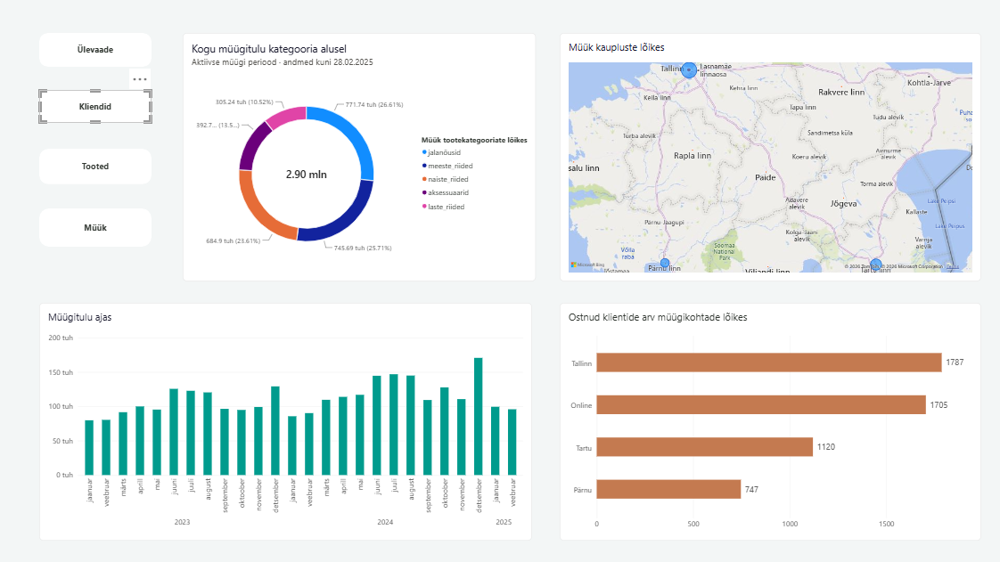

# Nädal 10 – UrbanStyle’i interaktiivne Power BI aruanne

**Autor:** Evelyn Uusmaa  
**Roll grupitöös:** B – visualiseerimine  
**Tööriist:** Power BI Desktop  
**Analüüsiperiood:** 01.01.2023–28.02.2025

## Eesmärk

Minu ülesanne oli koostada UrbanStyle’i müügiandmetest
interaktiivne aruanne, mis võimaldab võrrelda müügitulu,
ostnud klientide arvu ja müüdud toodete kogust.

Lähtusin varasemate nädalate Power BI tööst ning
koostasin nädala 10 esitluseks ühtse kujundusega aruande.

## Minu panus

- Koostasin müügitulu ajagraafiku ja tootekategooriate
  müügitulu jaotuse.
- Lisasin füüsiliste kaupluste kaardi.
- Koostasin müügikohtade võrdlused müügitulu,
  ostnud klientide arvu ja müüdud koguse järgi.
- Koostasin müüdud koguste võrdluse tootekategooriate kaupa.
- Lõin neli navigeerimisnuppu ja sidusin need järjehoidjatega.
- Seadistasin diagrammide nähtavuse eri vaadetes.
- Piirasin analüüsiperioodi kuupäevaga 28.02.2025.
- Ühtlustasin aruande värvid, teksti ja pealkirjad
  grupi kodulehe kujundusega.
- Lisasin andmesildid, et tulemusi oleks lihtsam
  lugeda ja esitleda.

## Peamised tulemused

| Näitaja | Tulemus |
|---|---:|
| Müügitulu kokku | ligikaudu 2,90 mln € |
| Tallinna müügitulu | ligikaudu 1,09 mln € |
| E-poe müügitulu | ligikaudu 1,00 mln € |
| Jalatsite ja meesteriiete osakaal müügitulust | ligikaudu 52,3% |
| Müüdud toodete kogus kokku | 18 323 tk |

Müügitulu ja osakaalud põhinevad aruandes kuvatud
ümardatud väärtustel.

## Aruande vaated

### 1. Ülevaade

Ülevaates on müügitulu ajagraafik,
tootekategooriate müügitulu jaotus,
kaupluste kaart ja müügitulu võrdlus müügikohtade kaupa.

Tallinn ja e-pood annavad suurima panuse müügitulusse.
Tootekategooriatest moodustavad jalatsid ja meesteriided
kokku üle poole müügitulust.

### 2. Kliendid

Klientide vaates näitab alumine diagramm
ostnud klientide arvu müügikohtade kaupa.

See võimaldab võrrelda, kui paljude ostnud klientideni
iga müügikoht jõudis. Täpsed väärtused on nähtavad
tulpade juures.

Sama klient võib osta mitmest müügikohast,
mistõttu ei võrdu nende arvude summa ettevõtte
unikaalsete klientide koguarvuga.

### 3. Tooted

Toodete vaates näitab alumine diagramm
müüdud kogust tootekategooriate kaupa.

Koguste võrdlus täiendab müügitulu jaotust:
müüdud tükkide arv ja rahaline tulemus
kirjeldavad müüki eri vaatenurkadest.

### 4. Müük

Müügi vaates võrreldakse müüdud toodete kogust
müügikohtade kaupa.

| Müügikoht | Müüdud kogus (tk) |
|---|---:|
| Tallinn | 6 914 |
| E-pood | 6 292 |
| Tartu | 3 288 |
| Pärnu | 1 829 |
| **Kokku** | **18 323** |

Tallinn ja e-pood on suurimad müügikohad
nii müügitulu kui ka müüdud koguse poolest.

## Interaktiivse lahenduse ülesehitus

Kasutasin ühte aruandelehte ja nelja navigeerimisnuppu:
Ülevaade, Kliendid, Tooted ja Müük.

Nupud käivitavad järjehoidjad, mis määravad,
millised diagrammid on nähtaval.
Ühised graafikud jäävad alles ning alumine
parempoolne diagramm vahetub vastavalt valitud teemale.

Erinevate mõõdikute jaoks kasutasin eraldi diagramme.
Järjehoidjad juhivad nende nähtavust,
mitte diagrammi mõõdiku vahetamist.

Kujunduses kasutasin heledat tausta, tumedat teksti
ja türkiisrohelist põhivärvi.
Oranž rõhuvärv aitab märgata vahetuvat diagrammi.

## Järeldused

- Tallinn ja e-pood on ettevõtte suurimad müügikohad
  nii müügitulu kui ka müüdud koguse järgi.
- Jalatsite ja meesteriiete tulemused mõjutavad
  oluliselt ettevõtte kogumüüki.
- Müügitulu, kogust ja klientide arvu tuleb vaadata koos,
  et mõista müügikohtade erinevusi.
- Tartu ja Pärnu väiksema müügi põhjused vajavad
  lisaanalüüsi, näiteks kaupluste suuruse,
  külastatavuse ja sortimendi võrdlust.
- Müügitulu üksi ei näita kaupluse kasumlikkust.

## Mida õppisin?

- Kuidas kasutada järjehoidjaid ja valikupaneeli
  diagrammide nähtavuse juhtimiseks.
- Kuidas siduda navigeerimisnuppe järjehoidjatega.
- Kuidas eristada müügitulu, müüdud kogust
  ja ostnud klientide arvu.
- Kuidas vormindada andmesilte ja kuvaühikuid,
  et arvud oleksid loetavad.
- Kuidas kohandada aruande kujundust
  ühise esitluse visuaalse stiiliga.
- Kuidas sõnastada graafikute pealkirju nii,
  et mõõdik ja ühik oleksid üheselt mõistetavad.

Oluline õppetund oli, et kopeeritud diagrammi puhul
tuleb üle kontrollida nii mõõdik, kategooriad
kui ka pealkiri. Ainult pealkirja muutmisest ei piisa.

## Piirangud

- Analüüs lõpeb 28.02.2025.
  2025. aasta kaks kuud ei ole otse võrreldavad
  varasemate täisaastatega.
- Sama klient võib esineda mitme müügikoha klientide seas.
- Kaardil on füüsilised kauplused.
  E-pood on kaasatud müügikohtade võrdlustesse.
- Müügitulu on graafikutel osaliselt ümardatud.
- Aruanne kirjeldab tulemusi;
  erinevuste põhjused vajavad täiendavat analüüsi.

## Artefaktid

- [Power BI aruanne](UrbanStyle_week10.pbix)
- Neli aruande eelvaadet, mis on kuvatud selle faili sees.
- Aruande kirjeldus, tulemused ja õpikogemus käesolevas failis.

Interaktiivseks kasutamiseks laadi PBIX-fail alla
ja ava Power BI Desktopis.
PNG-pildid on staatilised eelvaated.

## Seos grupitööga

Minu visualiseerimise osa täiendab grupi SQL-i
ja Pythoni tööd: SQL aitab andmeid ette valmistada
ja analüüsida, Power BI tulemusi uurida ja esitleda
ning Python analüüsi korrata ja automatiseerida.

[Grupitöö – UrbanStyle Sales Analytics, nädal 10](https://github.com/andres-assukyll/urbanstyle-sales-analytics/tree/main/week10)
